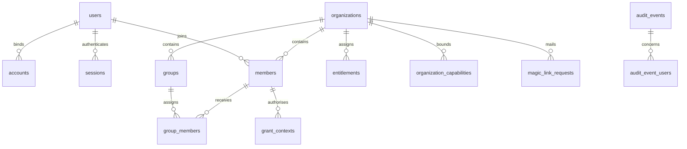

# Answerable ID schema foundation

This is the current storage contract. [Design](03-answerable-id.md) describes behaviour; [F0–F7](05-id-enterprise-foundation.md) defines acceptance. The unshipped development history is consolidated into a generated [initial migration](../apps/id/drizzle/0000_initial.sql) and a reviewed [invariants migration](../apps/id/drizzle/0001_invariants.sql); see [the layout](../apps/id/README.md#commands).

## Service contract

Bun, Hono and Better Auth 1.7.15 use Postgres for identity, sessions, protocol state, policy, audit and command recovery. The baseline has 26 tables, 21 custom functions, 40 triggers, 22 policies and eleven RLS-enabled tables. The reviewed migrations hold the custom SQL that drizzle-orm cannot express. A [catalogue-equivalence test](../apps/id/src/db/migrations.integration.test.ts) proves the committed migrations build exactly what the schema modules generate plus those files.

## Entity relationship diagram

Relations describe ownership, not physical deletion.

## Ownership

| Record                  | Security identity                                                                         |
| ----------------------- | ----------------------------------------------------------------------------------------- |
| User/account            | Global user UUID and unique upstream binding; never email linking.                        |
| Member/group/assignment | Tenant UUID, same-tenant foreign keys and immutable row UUIDs.                            |
| Client/resource         | Instance UUID, reserved public identifier and immutable ownership/classification.         |
| Capability              | Platform-approved tenant, exact targets, grant kind, scopes and effective window.         |
| Grant context           | Immutable authenticated user/member/tenant/client/resource and authentication provenance. |
| Audit/operation         | Permanent UUID attribution and reservations independent of product eligibility.           |

## Conventions

UUIDv7, timestamps, explicit validity predicates and monotonic revisions replace names as security identity. Window starts are inclusive and ends exclusive. Deleted rows are ineligible regardless of status/window.

Live uniqueness permits replacements only where explicitly defined. Group assignments have UUID primary keys. Partial entitlement/capability uniqueness uses `NULLS NOT DISTINCT`.

## Invariants

- Composite foreign keys reject cross-tenant member/group references. An entitlement or capability names a shared resource or its organisation's own, and a client no organisation owns or its organisation's own; a machine capability needs its organisation's own client.
- Tombstone rows keep unique public identifiers reserved after product deletion. Platform identity comes from immutable `system_bindings`; matching slugs cannot adopt it.
- **Live foreign keys hold soft deletion.** Each soft-deletable table has a `live` column: true while `deleted_at` is null, null once it is set. Parents carry `unique (id, live)` and children reference `(parent_id, live)`, so a live row needs live parents and a parent with live children cannot be deleted. `system_bindings` keeps the platform organisation, its admin group and the admin resource live. Every deletion path soft-deletes children first.
- **A deleted row holds no authority.** Per-table CHECKs require a disabled or revoked status, and no client secret, upstream refresh token or OIDC configuration. A trigger keeps deletion terminal and assigns `live`; writers never set it.
- **Sessions and tokens carry no liveness guard.** The issuing transaction checks and locks the user and client, and erasure deletes their sessions and tokens.
- **Trigger functions cannot be shadowed.** They schema-qualify every relation and search `pg_temp` last; the runtime role cannot create temporary tables.
- Session authentication and grant provenance cannot be rewritten.
- **An organisation's provider rows.** `sso_providers` holds up to one live row per organisation and kind (a partial unique index). `kind` is immutable. A directory is `oidc`, has its configuration while live and is always `enabled` (`sso_providers_enabled_check`). A `magic_link` row never has configuration, and `enabled` is the organisation's magic-link setting, on this row so that it and the row's `revision` cannot disagree: sessions and grants name a provider row and revision, so turning it off ends those at once and touches nothing else, and turning it back on revives neither, since a new revision never matches an old one. `protect_session_authentication_origin` refuses to make a session on a row that is off, so a session with standing is one made while the row was on.
- **Who may ask a firm's row for a link.** `admission` is `listed` by default, or `domain`; a directory is always `listed` (`sso_providers_admission_kind_check`). The revision guard ignores it, with `updated_at`: sessions and grants name a row's revision, and narrowing who may ask next leaves members as members, so changing it ends nothing. A first sign-in in `domain` mode creates the person: the same fields as a directory's first sign-in, in the sign-in's transaction, under the address's lock.
- **A domain's proof.** `organization_domains.verification_token` is unguessable and public: the firm publishes it in a TXT record at `_answerable-challenge.<domain>`, with the value `answerable-domain-verification=<token>`. The default is in the database, so the previous image's inserts get one too. `verified_at` is when the record was last seen, null until then and again once a re-check fails. A moved or re-added domain is a new row, so a new proof. Domain mode reads it per address: a domain added after the switch admits nobody new until it is proved. Nothing re-checks on a schedule: Not yet, and a lapsed domain someone re-registers stays proved until staff re-check it.
- **Every live organisation has its magic-link row.** The trigger `organizations_magic_link_provider` creates it when an organisation is inserted, on, with `provider_id` `magic-link:<organisation id>`, issuer `urn:answerable:magic-link` and domain `magic-link.invalid`; its function is `SECURITY DEFINER`, since bootstrap inserts the platform organisation before it sets a scope and RLS refuses an invoker's insert. An erased organisation's row is soft-deleted with it and nothing recreates it. Reads treat a live organisation with no row as a fault, and answer 500.
- **The platform organisation can never use magic links.** `sso_providers_platform_magic_link` refuses `enabled = true` on a row whose organisation has a `system_bindings` row, on any connection (`23514`), and `system_bindings_magic_link`, also `SECURITY DEFINER`, turns the row off when the binding is made, because RLS would filter an invoker's update to no rows without an error.
- **A magic-link request says what was mailed.** `magic_link_requests` holds one row for each email ID tried to send for a sign-in; a stranger writes none. A `link` row always has its token identifier, browser hash and code HMAC; a `connect_directory` row has a browser hash, a code HMAC and the verified directory identity, `directory_issuer`, `directory_subject` and `directory_user_id`, and no token, is never `new_address`, and names the directory's row and revision in `provider_id` and `provider_revision` where the others name the magic-link row's (`magic_link_requests_purpose_fields_check`). Its code connects an account and signs nobody in. A row is `sent` from when it is made, and `failed` once its send has failed: only `sent` can ever sign in, so `sent` means no failure has been recorded, not that the mail arrived. A `failed` row holds Postmark's code and status, loses its row in `verifications` in the same commit and counts against no limit. The row names its provider and revision at issue with no key, as a session's origin does, so that an insert takes no lock on a row commands update. `new_address` says no user held the address when it was asked for, which only domain mode admits; the budgets for such addresses count these rows, on partial indexes of their own, and the previous image's inserts are false. `attempts` counts comparisons with this request's code, committed before each comparison, and a row at three is ended; a right code takes its own back. Using the link or the code, or being refused at confirmation, ends the row by moving `expires_at` to that moment. The sweep removes it seven days after it was made, and retiring or erasing the address's holder removes it at once.
- **A magic link's account.** `provider_id` is the firm's row's, issuer `urn:answerable:magic-link`, `account_id` the address, on the user who holds it, with `identity.linked` when that user already has another account. Retiring or erasing the person rewrites `account_id` to `retired:<account id>`, because `accounts_issuer_account_id_unique` is not partial and the address must be free for its next holder. A session from such an account has `upstream_auth_time` null, lasts at most 24 hours from its creation however often it is read (its refreshes are skipped, in `auth/magic-link-confirm.ts`, since Better Auth's refresh would otherwise extend it), and its grants last 7 days.
- Native transaction/savepoint scope restores on success/failure; pooled connections retain no tenant authority.
- Successful effects, audit, audit users and command reservations commit together.

## Lifecycle values

Disabled state is reversible by explicit command. Membership revocation can be reinstated while the user, organisation and membership remain undeleted and eligible. Removed assignments and revoked grants stay removed/revoked. `deletedAt` is terminal product deletion; protocol consumption/expiry is separate.

## How the policy reads the schema

Registration limits vocabulary and identity; it does not grant permission. User access intersects own-tenant authentication, effective membership, capability and matching assignments. Client-only login and exact client–resource pairs are distinct. Refresh has an independent ceiling. Machine access uses owner, registration/link limits and its machine capability.

## Durable audit subjects

Audit tenant and user references do not depend on live product eligibility. `audit_event_users (user_id, event_id)` lists the users each event concerns: a user actor; the user, membership, group-membership, session or grant target; the member an entitlement names; and the users the action's manifests name (`audience`, `policySources.assignments`, revoked grant contexts, revoked, deleted or cleared tokens, consents and members). The two audit triggers fill it as the table owner; runtime cannot write it, and only platform scopes read it.

Current deletion manifests describe product tombstones and actual credential clearing/revocation. Tenant client history exposes counts and a link to platform-only grant effects. The nullable indexed `operation_id` has a deferrable, initially deferred foreign key to permanent receipts: audit can precede the receipt inside the transaction but no dangling reference can commit.

### Audit actions

Every event has `schema_version` 1, and each action one `data` shape; the first payload change after launch adds version 2. `reason` holds a refusal or failure code. Optional keys are marked. A command that changes nothing records no event: its receipt, with outcome `noop`, is the record. A [test](../apps/id/src/db/queries/audit.test.ts) keeps this table equal to the actions ID writes.

Soft-deleted entitlements, group assignments and memberships have one evidence shape wherever an erasure's `effects` lists them, ordered by `id`: the row's policy fields (identifiers, `revision`, scopes or status, validity window) and `deletedAt`. Assignments add the member's `userId`; memberships carry `userId`, `status` and `revokedAt`.

| Action | `data` |
| ------ | ------ |
| `admin.auth_failed` | Null. Written only once the credential verified: a disabled user, an untrusted or missing `Origin`, a client without an organisation, a disabled organisation. A missing or invalid credential writes no event, only the log line `admin_auth_refused` (request id, address, path, reason). |
| `admin.denied` | `organizationId` when the path names an organisation the principal holds no grant for, otherwise null. |
| `admin.root_request` | `organizationId` from the path, otherwise null. |
| `auth.magic_link.code_exhausted`, `auth.magic_link.refused` | `magicLinkRequestId`, `authenticationProviderId`, `authenticationProviderRevision`. The actor is the system `magic-link`, the target the person when the address has one and otherwise the request, and `reason` says why: `code_attempts` for the first; `access_removed`, `not_admitted`, `provider_changed`, `ended`, `token_consumed` or `account_conflict` for the second, and on a directory's connection `directory_changed`, `not_connectable`, `identity_taken` or `ended`, where the provider fields name the directory's row. Each needs the browser's real cookie and a real row, and one request writes one. |
| `auth.signin.succeeded` | `userId`, `authenticationAccountId`, `authenticationProviderId`, `authenticationProviderRevision`, `upstreamAuthTime`. |
| `auth.signout` | Null. |
| `bootstrap.applied` | Recorded only when a start created or changed something. `created` (true on the first start, which provisioned the platform), `resource` (the admin resource's `name`, `accessTokenTtl` and `allowedScopes` `before`, null on creation, and `after`), `capability` (the platform ceiling the first start seeded, otherwise null). |
| `capability.created`, `capability.updated` | `before` (null on creation), `after`. |
| `capability.removed`, `domain.deleted`, `group_member.removed` | `before`, `after`, `deletionMode: "soft"`; `group_member.removed` adds `groupId`; `domain.deleted` adds `magicLinkEffects`, the `revokedGrantContexts` and `deletedSessions` of that domain's addresses, each with `id` and `userId`. |
| `client.created`, `resource.created` | `before: null`, `after`. |
| `client.updated`, `resource.updated` | `requestedFields`, `before`, `after`. |
| `client.enabled`, `client.disabled` | `before`, `after`, `effects` (token counts), optional `grantEffectsEventId`. |
| `client.secret_rotated` | `before` and `after` `authorizationVersion`, `effects` (`credentialChanged`, token counts), optional `grantEffectsEventId`. |
| `client.resource_linked`, `client.resource_unlinked` | `resource`, `relationship` (`id`, `deletedAt`), `resourceInstanceId`, `resourceClassification`, `resourceOrganizationId`, `before` and `after` `linked`. |
| `client.grants_revoked` | Platform only: `clientInstanceId`, `grantContexts`, `revokedTokens` (`access`, `refresh`: row and user IDs). |
| `client.grants_erased` | Platform only: `clientInstanceId`, `grantContexts`, `effects` (deleted tokens, soft-deleted consents and links), `deletionMode`. |
| `client.erased` | `before`, `after`, `deletionMode`, `effects` (counts), optional `grantEffectsEventId`. |
| `domain.created` | `domain`, `before: null`, `after`. |
| `domain.enabled`, `domain.disabled` | `status`, `before`, `after`; `domain.disabled` adds `magicLinkEffects`, as `domain.deleted` does. |
| `domain.verified`, `domain.verification_lost` | `domain`, `before`, `after`. The first when a DNS check finds the record on a domain with no proof, the second when one finds nothing on a domain with a proof. Each row holds the domain's `verificationToken`, which is public by design. |
| `entitlement.created`, `entitlement.updated`, `entitlement.enabled`, `entitlement.disabled` | `before` (null on creation), `after`, `audience`: the memberships the entitlement reaches (its member, its group's assignments, or every member). |
| `entitlement.removed` | `before`, `after`, `deletionMode`, `audience`. |
| `group.created`, `group.updated` | `before` (null on creation), `after`. |
| `group.enabled`, `group.disabled` | `before`, `after`, `policySources` (`assignments`, `entitlements`). |
| `group.erased` | `before`, `after`, `deletionMode`, `effects` (`softDeletedAssignments`, `softDeletedEntitlements`). |
| `group_member.added`, `group_member.updated` | `groupId`, `before` (null when added), `after`. |
| `identity.linked` | A directory identity added from a session: `initiatingSessionId`, `initiatingAccountId`, `authenticationProviderId`, `authenticationProviderRevision`, `upstreamAuthTime`, `flowId`. A magic link added beside another account: `magicLinkRequestId`, `authenticationProviderId`, `authenticationProviderRevision`, `upstreamAuthTime` (null). A directory added by a code from the mailbox: the same four, naming the directory's row, with the request's client on the row. |
| `member.imported` | One per membership an import made: `userId`, `userCreated`, `before: null`, `after` (`membershipStatus`). An address that changed nothing writes none. |
| `member.updated` | `changes`, `before`, `after`, each state with its `access`. |
| `member.removed` | `userId`, `reason`, `before`, `after` (with `access`), `effects` (`removedGrants`, `softDeletedAssignments`, `revokedGrantContexts`). |
| `member.reinstated` | `userId`, `reason`, `before`, `after` (with `access`). |
| `oauth.token.issued` | `decision`, `issuedAt`, `expiresAt`. |
| `oauth.token.rejected` | `grantType`, `stage`, `authenticatedClient` and `decision`. Written only once the client authenticated; a failed client authentication is the log line `token_rejected`. |
| `oauth.user.authorized`, `oauth.user.denied` | `scopes`, `decision`. |
| `oauth.user.issued` | Recorded for the code exchange only, not for a refresh. `grantType`, `scopes`, `decision`. |
| `oauth.user.revoked` | `reason` (`authorization_code_replay`, `refresh_token_replay`, `revocation_request`), `effect` (`grant`, `refresh_family`, `access_token`). |
| `organization.created`, `organization.updated`, `organization.enabled` | `before` (null on creation), `after`. |
| `organization.disabled` | `before` and `after` (`status`, `authorizationVersion`), `effects` (`revokedMachineAccessTokenIds`, `revokedGrantContexts`). |
| `organization.erased` | `before`, `after`, `deletionMode`, `revokedGrantContexts`, `effects` (the soft-deleted entitlements, assignments, members, groups, capabilities, domains and SSO providers). |
| `organization.magic_link_enabled`, `organization.magic_link_disabled` | `before` and `after` (`enabled` and the magic-link row's `revision`). |
| `organization.magic_link_admission_changed` | `before` and `after` (`admission` and the magic-link row's `revision`, the same in both). |
| `resource.enabled`, `resource.disabled` | `before`, `after`, `effects.revokedGrantContexts`. |
| `resource.erased` | `before`, `after`, `deletionMode`, `revokedGrantContexts`. |
| `session.revoked_all` | `userId`, `sessions`, `sessionIds`, `revokedGrantContexts`, token counts, `revokedTokens`. |
| `sso_provider.created`, `sso_provider.updated` | `before` (null on creation), `after`, `credentialsChanged`, `effects.revokedGrantContexts`. |
| `sso_provider.deleted` | `before`, `after` (with `credentialsCleared`), `deletionMode`, `effects.revokedGrantContexts`. |
| `user.enabled`, `user.email_retired` | `before`, `after`. |
| `user.disabled` | `before`, `after`, `sessions`, `sessionIds`, `revokedGrantContexts`, token counts, `revokedTokens`. |
| `user.erased` | `before`, `after`, `deletionMode`, `revokedGrantContexts`, `effects` (deleted tokens and sessions, soft-deleted consents, entitlements, assignments, members and accounts, cleared token sessions). |

## Runtime database permissions

Schema owner and runtime roles are separate. Runtime cannot DELETE/TRUNCATE product rows or grant contexts (it can delete `magic_link_requests`, which are protocol records the sweep removes), rewrite audit, write audit users, alter reservations, change system binding, rewrite or delete signing keys, rewrite client-assertion replay markers or create temporary tables. Those privileges, not triggers, keep bindings and operation receipts immutable. Besides the two audit triggers, two more functions run as the table owner, for a magic-link row made with its organisation and turned off with the platform binding; both write fixed values, and execution of them, and of the `uuid_v7()` they use, is revoked from `PUBLIC`. Protocol records retain their consumption contract. Startup checks protected privileges, ownership, `TEMP` and required RLS before listening.

RLS protects `groups`, `group_members`, `entitlements`, `organization_capabilities`, `grant_contexts`, `members`, `organization_domains`, `sso_providers`, `magic_link_requests`, `audit_events` and `audit_event_users`. `magic_link_requests` holds addresses, so with no scope it holds no rows: only `protocol` reads and writes it, and platform and tenant scopes read it, a tenant its own organisation's, for diagnosis. Routing SELECT and audit INSERT remain available without scope; a tenant scope reads only its own organisation's domains and SSO providers. Seven transaction scopes select the rows: `protocol`, `platform-read`, `platform-write`, `tenant-read`, `tenant-write`, `policy-user` and `grant-client`. Native broker transactions use protocol scope. Grant admission is the user's `policy-user` scope bound to the authenticating session: it inserts only that session's grant for that user. This is targeted protection, not universal RLS. The [isolation inventory](../reports/answerable-id-isolation-inventory.md) records scopes and trusted exceptions.

## Completed administrative operations

All 49 mutations share the journal; a mutation sent without an `Idempotency-Key` is journalled under a server key. Actor, tenant scope, operation kind, target and normalised input identify a reservation. Matching retries require current authority and return the receipt without repeating effects; mismatches conflict.

Reservations are permanent. Replays return receipts at the original status code, with an empty body for 204. Response bodies are not stored.

## Contract test

`db:test:migrate` installs every migration on an empty database before each suite, and the migration-script test proves a repeated run applies nothing. The catalogue-equivalence test covers tables, constraints, indexes, functions, triggers, policies and permissions. Bootstrap tests cover concurrent first starts; migration refuses an applied file that changed. Statement failure and process death need no proof of ours: the migrator applies every pending file in one transaction. Recovery is in [the foundation's §6](05-id-enterprise-foundation.md#6-interruption-external-effects-and-money).

## Deferred

ID deletes expired sessions, OAuth access and refresh tokens, client assertions and verifications on a timer, and magic-link requests seven days after they were made: protocol expiry is not product deletion and records no audit. Better Auth's own clean-up of `verifications` is off, so no sign-in deletes rows under its locks. Physical product purge jobs and their duration remain deferred. No named-identity recovery feature is required. DNS self-verification, guest opt-in, SCIM, external registration and remote logout delivery are outside this baseline; see the [plan](02-plan.md).

## Client configuration revisions

Conditional PATCH uses ETags. Security changes advance authorisation versions and revoke applicable stored grants. Public IDs/owners cannot be transferred to adopt old credentials.

## Resource configuration revisions

Conditional PATCH preserves immutable identity/classification. Scope/lifecycle changes affect current decisions. Deletion rejects retained live references, including inactive/future policy rows.

## Membership revocation

Removal revokes the membership and matching grants, soft-deletes direct assignments and preserves other tenants. Terminally deleted membership cannot be reinstated.

## Organisation authorization version

Security transitions advance the version. Re-enable alone cannot restore old token authority.

## Global session boundary

Browser sessions are global. Tenant APIs cannot enumerate/revoke them globally. Tenant deletion leaves them in place; platform session/user commands apply their explicit global effects.

## Authentication transaction boundary

Verified SSO provenance enters the session through the native callback transaction. Production OAuth checks current policy under the grant's locks before native issuance, the claims callback refuses a grant or client that differs from that decision, and mandatory user OAuth audit commits with each authorisation, code exchange and revocation; a successful refresh records no audit event. Client assertion replay protection stays consumed if later issuance rolls back.

A magic link's sign-in has its own one transaction, in protocol scope, reached only from the pages. It takes the address's advisory lock, then the user, the organisation and the provider row in the callback's order, sharing each, then the request row. Holding those it compares the browser cookie's hash with the row, re-reads admission, and refuses a revision that differs from the row's. Only then does it ensure the account, consume the token by its stored identifier and make the session, with `upstream_auth_time` null. A command that ends what this makes either commits first, and this refuses, or waits, and finds the session to end: a domain's commands hold the organisation, and the switch moves the revision. A code's attempt commits in a transaction of its own before anything compares it, so a refusal here rolls back nothing it counted. A refusal leaves its audit row after the rollback, in a transaction that also ends the request.

## Resource link deletion boundary

Links have immutable UUIDs and terminal tombstones. Relinking creates a new relationship. Grant revocation is retained.

## Machine issuance evidence

Issue facts retain approved identity/policy and actual issue/expiry times. Rejection facts are written only after client authentication; failed credentials and refused SSO callbacks are log lines (`token_rejected`, `signin_rejected`), not rows. Audit failure cannot turn refusal into success.

## Member command receipts

Window changes, removal and reinstatement share tenant authority, audit and replay. Before/after access is observed at each statement; it does not prove remote logout or isolate all concurrent causes.

## Domain command receipts

Lifecycle commands use current platform authority, routing state and repeat-safe results. Domain deletion cannot make an old grant eligible again.

## Organisation command receipts

Creation/configuration/lifecycle share the journal. Deletion retains tenant children as tombstones and preserves global people. The magic-link switch locks the organisation, then its row; a command that changes nothing moves no revision and records no event.

## Keyed command fingerprints

Administrative commands use a SHA-256 digest of canonical identity and input. Permanent reservations retain outcome, status and result reference, without response bodies.

## SSO command receipts

PUT accepts optional expected absence or current revision; without a precondition it uses the current row. Old provider revisions cannot confer current authority. Audit redacts provider secrets.

## Group command receipts

Lifecycle shares the journal and revision checks. Deletion captures actual assignment/entitlement UUIDs.

### Group assignment identities

Every assignment has its own UUID/revision. Window PUT accepts an optional absence/revision precondition. Removal and re-creation are distinct identities.

### Entitlement command recovery

Original keys return receipts; replay cannot broaden permission.

### Entitlement revisions

PATCH uses ETags. Changed entitlements record their audience (the member, the group's assignments or every member) without claiming every observed user gained/lost access.

### Global session command recovery

Revocation records actual session/token/grant effects. Old keys recover old commands; a new reconciliation uses a new key.

### Global user command recovery

Disable reconciles remaining local credentials even for an already-disabled user. Deletion retains UUID history and denies authority atomically with its receipt.

### Tracing a command

A command's `Operation-Id` filters the audit event lists (`?operationId=`); the receipt itself is read only through a replay with the same key.

## Organisation capability ceilings

Only platform writers approve ceilings. Registration, assignment and approval remain independent.

## User grant context

One server-bound flow creates one immutable grant. Its authentication evidence is copied from the session's origin into four columns named as on `sessions`: `authentication_account_id`, `authentication_provider_id`, `authentication_provider_revision` and nullable `upstream_auth_time`. The issuing transaction checks them, with the member, user, organisation, client and resource, under its own locks; RLS admits the insert only for the user and session it names, and the `(organization_id, member_id)` foreign key keeps the member in the grant's organisation. An update trigger allows only one code binding before revocation and an irreversible revocation. Account, provider revision, tenant and verified time stay fixed across code and refresh. Grants are never deleted: runtime has no DELETE on `grant_contexts`, and its five foreign keys restrict.

### User-capability administration

Code, refresh, machine and direct admin-session grant kinds are explicit. One approval does not approve another.

## Native SSO session origin

Verified upstream `auth_time` is nullable and never replaced by broker creation time. Sensitive human commands require five-minute freshness before replay and after relevant waits. Linking requires two independent proofs and cannot transfer bindings.

## Soft deletion

Fourteen product tables carry `deletedAt`: users, organisations, accounts, members, groups, assignments, entitlements, domains, SSO providers, clients, resources, client-resource links, consents and capabilities.

Ordinary reads/authentication/authorisation exclude them. User deletion retires email and retains profile/bindings. Credentials are cleared/revoked; native sessions/token rows can be physically consumed/deleted. Grant contexts retain revocation; audit, reservations and recovery survive. This retains identifying data and is not anonymisation. The [audit actions](#audit-actions) give each deletion's evidence; the public [deletion table](../apps/web/content/docs/id/manage.mdx#deletion-and-retained-data) gives what each command removes and retains.
