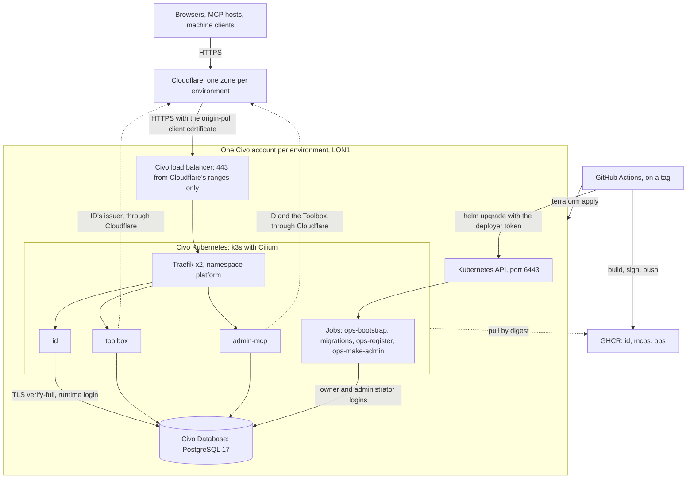

# Deployment

> **TL;DR**
> - **Decides:** where Answerable ID, the Toolbox, the admin MCP and every MCP run outside a laptop, and why: Civo London, one Civo account per environment, one Helm chart on Civo Kubernetes, Civo Database PostgreSQL 17, Cloudflare in front, every secret in a GitHub environment or generated where it is used, a tag `staging/<name>` shipping staging and a tag `production/<name>` shipping production behind the owner's approval. Nothing is done by hand from a laptop.
> - **Rule:** only Cloudflare reaches the services, and only with the origin-pull certificate; no service holds a database owner login; the cluster runs images by digest, built from a commit that passed CI and shipped to staging first; no secret sits in plain text in git, in a Terraform variable or in a log.
> - **Not here:** how to do each step ([`infra/README.md`](../infra/README.md), the runbook), what ID itself needs from any deployment ([`06-deploying-answerable-id.md`](06-deploying-answerable-id.md)), the decisions with the alternatives they rejected ([`goals/civo-deploy/decisions.md`](goals/civo-deploy/decisions.md), D-numbers below), the measured evidence from the first staging run ([`reports/staging-evidence.md`](../reports/staging-evidence.md)).

**Status.** Everything below is code in this repository, proved locally (§ [Testing](#testing)). Staging has run on Civo: `staging/fourth` passed its smoke test on 2026-10-23 ([`reports/staging-evidence.md`](../reports/staging-evidence.md)), as the release before the `mcps` image and the `mcp` hostname; the first tag that ships them has not been pushed. Production: Not yet. It waits for the rehearsal ([B7c](goals/civo-deploy/briefs/b7c.md)). The web app stays on Vercel.

## What runs where

| Piece | Where | Count per environment | Defined in |
| --- | --- | --- | --- |
| **Answerable ID** (`id`) | Deployment in namespace `answerable`, port 47300 | 2 to 4 (staging), 2 to 6 (production) | [`charts/answerable`](../charts/answerable/README.md) |
| **The Toolbox** (`toolbox`) | Deployment in `answerable`, port 47400, from the `mcps` image; mounts every `toolbox` and `both` MCP of `charts/answerable/mcps.json` in its hub, and serves every `standalone` and `both` one at `https://mcp.<zone>/<name>/mcp` ([D-1](goals/pr13-audit/decisions.md)) | 2 to 3, 2 to 4 | the same |
| **The admin MCP** (`admin-mcp`) | Deployment in `answerable`, port 47520, from the `mcps` image | 2 to 3, 2 to 4 | the same |
| **Migrations and ops Jobs** | Helm hook Jobs in `answerable`: `ops-bootstrap`, `id-migrate`, `toolbox-migrate` (the Toolbox's database, then every MCP), `admin-migrate`, `ops-register`, `ops-make-admin` | one run per deploy, `register` included; `make-admin` on request | the same, and [`infra/ops`](../infra/ops/README.md) |
| **Traefik** (the edge in the cluster) | Deployment in namespace `platform`, behind a Civo load balancer | 2 | [`charts/platform`](../charts/platform/README.md) |
| **PostgreSQL 17** | Civo Database on the environment's private network: `answerable_id`, `answerable_toolbox`, `answerable_admin`, `answerable_mcps` (a schema per shared MCP) and `answerable_mcp_<name>` per MCP with a database of its own | 1 node | [`infra/civo`](../infra/civo/README.md) |
| **Cluster, network, firewalls, Cloudflare zone, certificates, the GitHub environment's deploy secrets** | One Civo account, one Cloudflare zone and one GitHub environment per environment, Civo region LON1 | 2 nodes (staging), 3 nodes (production), Medium | `infra/civo`, `envs/<environment>.tfvars` |
| **The state bucket** | Civo object store in the environment's account | one 500 GB block | `bootstrap.yml` |
| **Images** | GHCR, public: `ghcr.io/rieranthony/answerable/{id,mcps,ops}`, amd64, listed in [`infra/pipeline/images.json`](../infra/pipeline/images.json) | one per image and commit | the Dockerfiles, `deploy-staging.yml` |
| **The pipeline** | GitHub Actions: `ci.yml`, `bootstrap.yml`, `deploy-staging.yml`, `promote-production.yml`, `ops.yml` | | [`infra/pipeline`](../infra/pipeline/README.md) |

| Hostname | Staging (zone `answerable-staging.uk`) | Production (zone `answerable.org`) |
| --- | --- | --- |
| ID, the issuer | `id.answerable-staging.uk` | `id.answerable.org` |
| The Toolbox | `toolbox.answerable-staging.uk` (resource `/mcp`, admin API `/admin`) | `toolbox.answerable.org` |
| The admin MCP | `admin-mcp.answerable-staging.uk` (resource `/mcp`) | `admin-mcp.answerable.org` |
| The MCPs the Toolbox serves alone | `mcp.answerable-staging.uk` (resource `/<name>/mcp` per MCP), routed to the Toolbox | `mcp.answerable.org` |

**The MCPs every environment mounts today: `e2e` and `example`** ([D-5](goals/pr13-audit/decisions.md)). There is no per-environment switch ([MCP CLI D10](goals/mcp-cli/decisions.md)), so the Toolbox of staging and of production serves both, as their `mcp.json` files say. `e2e`, served both ways, is the target of every deploy's smoke test; `example` is the docs' MCP, whose files the docs include. No organisation sees either until staff enable it for that organisation (`toolbox_enable` or `standalone_enable` in the admin MCP) and grant it. The risk is a mistake by staff: enabling a test MCP for a client.

Every name is first-level in its zone, so Cloudflare's Universal SSL covers it without an add-on ([D12](goals/civo-deploy/decisions.md)). A new MCP adds no name: the Toolbox serves each by path on `mcp` ([MCP CLI D2](goals/mcp-cli/decisions.md), [D-1](goals/pr13-audit/decisions.md)). Production's records sit beside Vercel's DNS-only `www`, which Terraform never touches.

The Toolbox and the admin MCP call ID at its public issuer, through Cloudflare, so one URL is the issuer everywhere.

## Accounts and access

| Who or what | Holds | Reaches |
| --- | --- | --- |
| **The owner** | Each Civo account's API key, each zone's Cloudflare token, the Entra app's credentials and a fine-grained GitHub token, pasted once into each GitHub environment and kept in the vendors' consoles | Everything, through GitHub; the Civo dashboard for break-glass |
| **The `staging` GitHub environment** | The five pasted secrets (`CIVO_TOKEN`, `CLOUDFLARE_API_TOKEN`, `MICROSOFT_CLIENT_ID`, `MICROSOFT_CLIENT_SECRET`, `GH_SECRETS_TOKEN`); what `bootstrap.yml` generates (`STATE_ACCESS_KEY_ID`, `STATE_SECRET_ACCESS_KEY`, `BETTER_AUTH_SECRET`, `ROOT_ADMIN_SECRET`); what Terraform writes (`KUBE_SERVER`, `KUBE_CA`, `KUBE_TOKEN`); optionally `GOOGLE_CLIENT_ID`, `GOOGLE_CLIENT_SECRET`, `BETTER_AUTH_SECRETS` | Deployments from `main` and the tags `staging/*` only. Each workflow step is handed only the secrets it names |
| **The `production` GitHub environment** | The same for production, behind the owner's approval | `main` and `production/*` only, with the owner as required reviewer |
| **The `deployer` ServiceAccount** | A token Terraform creates and writes into the environment | Only what `helm upgrade` of `charts/answerable` touches in `answerable`: no other namespace, no wildcard, no `escalate`, `bind`, `impersonate` or `exec` |

- **One Civo account per environment** under one Civo organisation ([D28](goals/civo-deploy/decisions.md)): a staging credential, bug or Terraform mistake cannot touch production. It is the strongest boundary Civo offers. Teams live in Civo's dashboard: the owner in each account's Owners team with MFA on the login.
- **No long-lived cloud key in the deploy step.** Civo has no federation and no scoped API keys: a key is per account, unscoped, with no documented expiry. The Terraform step is handed it; the deploy step is handed the namespace-scoped `deployer` token and ID's secrets ([D25](goals/civo-deploy/decisions.md)).
- **The owner's personal 1Password is not used** by any automation ([D28](goals/civo-deploy/decisions.md)).
- **Break-glass access** to a cluster is its admin kubeconfig: the sensitive Terraform output `admin_kubeconfig`, or Civo's own (`civo kubernetes config`), for diagnostics and recovery only ([runbook](../infra/README.md#break-glass)).
- **The state is a secret.** Civo's provider keeps the database administrator's password and the admin kubeconfig in Terraform state, which also holds the deployer's token, the private keys of the two certificates and the plaintext of the three deploy secrets Terraform writes into the environment. The state bucket's credential is therefore guarded like `CIVO_TOKEN`.

## Network and ingress

A request travels Cloudflare → the Civo load balancer → Traefik → a service. Each hop checks the one before it.

| Layer | What it enforces |
| --- | --- |
| **Cloudflare** ([D18](goals/civo-deploy/decisions.md), [D19](goals/civo-deploy/decisions.md)) | Proxied A records for the four hostnames; SSL Full (strict); Always Use HTTPS; TLS 1.2 minimum, TLS 1.3 on; HSTS for a year (no subdomains, no preload); zone-level Authenticated Origin Pulls with Answerable's own client certificate, made and uploaded by Terraform; on the four hostnames no Browser Integrity Check, Security Level essentially off, and no cache except `/assets/`. Bot Fight Mode is off by hand: the token cannot change it. All of it is Terraform, in the `edge` module, except Bot Fight Mode |
| **Load balancer firewall** | TCP 443 from Cloudflare's published IPv4 ranges only, read by Terraform at apply time; no port 80 |
| **Traefik** ([D31](goals/civo-deploy/decisions.md), [D35](goals/civo-deploy/decisions.md)) | TLS with the Origin CA certificate Terraform requested from Cloudflare (the Secret `origin-tls`, trusted by Cloudflare alone); every TLS connection must present a client certificate signed by the environment's origin-pull CA, through the TLSOption `default`, which applies to every router; strict SNI; `X-Forwarded-For` kept only from Cloudflare's ranges and the private network, and the connecting address appended |
| **NetworkPolicy** | Default deny in `answerable`; each service admits only Traefik's pods; egress to DNS, the database's network and HTTPS outside the private ranges; the migrations reach DNS and the database only |
| **ID** | `TRUSTED_PROXY_CIDRS`, read from the ConfigMap `trusted-proxies` Terraform writes: Cloudflare's 22 ranges, the private network and the pod range `10.42.0.0/16`; a production request to `/auth/*` or `/api/admin/*` with no untrusted address left is refused `403 untrusted_ingress` |

- **Private network.** Each environment has its own Civo network (`10.10.0.0/24` staging, `10.20.0.0/24` production) holding the nodes, the load balancer and the database, and nothing else.
- **Three firewalls.** The **cluster's**: 6443 (the Kubernetes API) from the internet, and from the private network only the node ports, the kubelet and Cilium's tunnel and health checks. The **load balancer's**: 443 from Cloudflare. The **database's**: 5432 from the private network.
- **Why the private network is trusted for forwarded headers.** No PROXY protocol is configured, so Traefik's peer is the load balancer's private address; trusting that range is what keeps Cloudflare's `X-Forwarded-For`. Whether that holds on Civo is a first-apply question ([`infra/civo/README.md`](../infra/civo/README.md#what-the-first-apply-must-confirm)).
- **The Kubernetes API is reachable from the internet** in both environments, authenticated by the cluster ([D30](goals/civo-deploy/decisions.md)): Civo clusters always have a public address, GitHub's hosted runners cannot be listed in a firewall, and every default Civo cluster has the same posture. TLS first, then a credential: the deployer token, which reaches one namespace, or the admin certificate, which exists only in Terraform state. A GitOps controller pulling from inside the cluster is the hardening if it is ever wanted.

## Compute

- **Kubernetes, because it is what Civo sells**, and because rolling deploys, scaling and self-healing come with it ([D20](goals/civo-deploy/decisions.md)). Civo Kubernetes is k3s with Cilium; Civo's own Traefik is removed and ours is installed by the platform chart, so the version is pinned in the repository.
- **One chart, `charts/answerable`** ([D21](goals/civo-deploy/decisions.md)): per server a ServiceAccount, Deployment, Service, Ingress, HorizontalPodAutoscaler and PodDisruptionBudget, plus the migration and ops Jobs. Per environment a values overlay: `values-civo-staging.yaml`, `values-civo-production.yaml` (and `values-local.yaml` for the kind stack).
- **Scaling.** HorizontalPodAutoscalers on CPU (60% of requests): ID 2 to 4 in staging and 2 to 6 in production, the MCPs 2 to 3 and 2 to 4. Replicas spread over nodes; production refuses to place two replicas on one node (`DoNotSchedule`). Each PodDisruptionBudget allows one pod down at a time.
- **Rolling deploys.** `maxUnavailable: 0`, `maxSurge: 1`; readiness on `/readyz` (ID) and `/health` (the MCPs); a startup probe; liveness on `/healthz` for ID and a TCP check for the MCPs, so that a database outage does not restart every MCP pod. `helm upgrade --rollback-on-failure --wait` rolls the release back when a Job fails or the pods never become ready. A changed secret rolls ID on the next tag through a checksum annotation. A terminating pod waits five seconds before it stops, because Traefik keeps routing to it for a few seconds after Kubernetes marks it terminating (2.5 s measured in the kind stack) and the servers stop within a second of the signal.
- **Restricted Pod Security** is enforced on `answerable` and on `platform`: every container runs as a non-root user, with a read-only root filesystem, no privilege escalation, every capability dropped and seccomp `RuntimeDefault`; no pod mounts a ServiceAccount token except the ops Jobs.
- **The MCP servers wait for their client secrets.** The Toolbox and the admin MCP render at zero replicas until `ops-register` has written `toolbox-id-client` and `admin-id-client`; the register Job then starts them.
- **One image for every MCP server** ([MCP CLI D8](goals/mcp-cli/decisions.md)). `mcps` holds the Toolbox, the admin MCP and every MCP under `mcps/`; each Deployment and migration Job names its command. A new MCP needs no image, no Dockerfile line and no GHCR package.
- **Images.** From `oven/bun:1.3.1-slim` pinned by digest, built for linux/amd64 (Civo's nodes are amd64, [D36](goals/civo-deploy/decisions.md)), non-root, `NODE_ENV=production`, no test, coverage, `.env` or Markdown file. Measured on arm64 at build time: `id` 287 MB, `ops` 218 MB (civo-deploy); `mcps` 262 MB (25 October 2026, with e2e and example), where `toolbox` was 247 MB and `admin-mcp` 218 MB.
- **Nodes.** Medium (2 vCPU, 4 GB): two in staging, three in production, so that one can drain for maintenance with two replicas per service still on different nodes.

## Database

| | Staging | Production |
| --- | --- | --- |
| **Service** | Civo Database, PostgreSQL 17, **in beta** (Civo offers no other version) | the same |
| **Size** | Small: 2 vCPU, 4 GB, 40 GB NVMe | Medium: 4 vCPU, 8 GB, 80 GB NVMe |
| **Nodes** | 1 | 1, until a failover has been measured ([D37](goals/civo-deploy/decisions.md)) |
| **Reach** | 5432 from the private network only | the same |

- **Two logins per database** ([D5](goals/civo-deploy/decisions.md)): an owner (`answerable_<name>_owner`) that only the migration Jobs receive, and a runtime login (`answerable_<name>_runtime`) the service runs as. Every service refuses to start as an owner or a privileged role. The `ops-bootstrap` Job creates the databases, their logins and their URL Secrets with Civo's administrator login, which Terraform writes into the Secret `postgres-admin` and which no service receives.
- **The MCPs' database** ([MCP CLI D1](goals/mcp-cli/decisions.md), with grants in place of per-MCP roles since [D-3](goals/pr13-audit/decisions.md)). A `shared` MCP is a schema of `answerable_mcps`. The database has two logins whatever the number of MCPs, and no role per MCP: its owner, `answerable_mcps_migrator`, which owns every MCP's schema and tables and migrates them; and `answerable_mcps_toolbox`, which the Toolbox serves every MCP as, granted `USAGE` on each schema and read and write on its tables, and owning nothing, so that row-level security binds it. A borrowed connection sets the MCP's schema as its search path and the caller's organisation. An `own` MCP has a database `answerable_mcp_<name>` with its owner and runtime logins, granted the same way. `ops-bootstrap` makes the schemas from `charts/answerable/mcps.json`, then `toolbox-migrate` migrates every MCP and grants the serving login its tables. Provider code is trusted: a query in one MCP may name another's schema, and still sees only the caller's organisation.
- **Verified TLS.** Every URL ends `?sslmode=verify-full&sslrootcert=/etc/ssl/db/ca.pem`; the chart mounts the ConfigMap `postgres-ca` there. Civo documents nothing about TLS for its database (the first staging run answered it, 23 October 2026: it serves TLS, with a private `dbaas-ca` root valid for one year and a leaf naming Civo-internal DNS names only; `reports/staging-evidence.md`) and its Terraform resource exposes no certificate, so the bootstrap Job records the certificate the database presents on its first run, **trust on first use** inside the private network, and logs its SHA-256 fingerprint for the owner to record ([D38](goals/civo-deploy/decisions.md)).
- **Backups.** Civo's page says "automatic backups" and documents no schedule, retention or restore. The `civo` CLI offers `database backup` and `database restore`. A restore drill on Civo precedes any production data ([D26](goals/civo-deploy/decisions.md)); its RTO and RPO are B7a's measurements. A restored database is unreadable without the keys that were active when its rows were written; rotation never replaces `BETTER_AUTH_SECRET` ([runbook](../infra/README.md#restore)).
- **Connections.** Each ID process opens up to 20 (`DATABASE_POOL_MAX`) and every other pool up to 10 (pg's default). At the autoscalers' ceilings:

  | Pool | Per replica | Staging | Production |
  | --- | --- | --- | --- |
  | ID | 20 | 4 × 20 = 80 | 6 × 20 = 120 |
  | The admin MCP | 10 | 3 × 10 = 30 | 4 × 10 = 40 |
  | The Toolbox: its database and `answerable_mcps` | 2 × 10 | 3 × 20 = 60 | 4 × 20 = 80 |
  | **Total, shared MCPs only** | | **170** | **240** |
  | Each `own` MCP, which the Toolbox serves | 10 | + 3 × 10 = 30 | + 4 × 10 = 40 |

  Plus one connection per running Job. A shared MCP adds no pool. Civo's `max_connections` per size is measured in B7a: Not yet. Until then `bun mcp check` takes PostgreSQL's default, 100, which these totals already pass, and warns whenever an `own` MCP adds to them (`scripts/mcp/connections.ts` holds the same numbers, held to the overlays by its test). The pools open connections on demand, so the ceiling is the worst case, not the measured load.
- **Growth.** ID's `audit_events` and `admin_operations`, and the MCPs' evidence, are kept forever. ID records an audit event for each code exchange and none for a refresh. At 100 organisations of 1,000 users (the activity measured on 6 October 2026) that is about 15 GB a month: production's 80 GB fills in about five months, and Civo bundles storage with the size. Deciding retention ([`Q-EVIDENCE-RETENTION`](02-plan.md#open-register)) is a prerequisite for production data on Civo.

## Secrets

**Every secret lives in the GitHub environment, or is generated where it is used; nothing is done from a laptop** ([D23](goals/civo-deploy/decisions.md), [D33](goals/civo-deploy/decisions.md)).

- **What a person provides** goes once into the GitHub environment, pasted in the browser: the Civo key, the Cloudflare token, the Entra client ID and secret, and a fine-grained GitHub token for this repository with read and write on Environments alone (the permission that writes environment secrets; managing the environment itself would need repository administration, which can also delete the repository, so the environment's policy and reviewer are the owner's, set once). GitHub encrypts each value with a libsodium sealed box before it reaches GitHub, stores it write-only, masks it in logs and hands it only to the workflow steps that name it.
- **What a workflow generates** goes into the environment the same way: `bootstrap.yml` creates the state bucket's credential in Civo and ID's two random secrets, each only when missing, and rotates `ROOT_ADMIN_SECRET` on request.
- **What Terraform makes** stays in its state and goes where it is used: the deploy credentials into the GitHub environment (the `github` module), the database administrator's URL, the origin certificate and the trusted proxies into the cluster (the `platform` module), the origin-pull certificate to Cloudflare (the `edge` module). Terraform holds no secret as input.
- **What the ops Jobs generate never leaves the cluster.** `ops-bootstrap` writes the database URLs and `ops-register` the three machine-client secrets, its own among them, straight into Kubernetes Secrets. A rebuilt cluster re-runs both: bootstrap sets a new password for a login whose Secret is gone, register rotates a client secret it cannot find. Register's own secret is rotated by the root secret that mints it: before the lock, or with break glass after.
- **Kubernetes Secrets rest in Civo's etcd**, whose encryption at rest is undocumented.

| Secret in `answerable` | Keys | Written by | Rotated by |
| --- | --- | --- | --- |
| `id-env` | `BETTER_AUTH_SECRET`, `ROOT_ADMIN_SECRET`; `MICROSOFT_CLIENT_ID` with `MICROSOFT_CLIENT_SECRET`, the Google pair and `BETTER_AUTH_SECRETS` when set | The deploy, from the GitHub environment, on every tag | `bootstrap.yml` with `rotate`, or a new value in the environment; the next tag applies it and rolls ID |
| `postgres-admin` | `OPS_DATABASE_ADMIN_URL` | Terraform, from the database's administrator login | Civo rotates the administrator; `terraform apply` rewrites the Secret |
| `origin-tls` | `tls.crt`, `tls.key`: the Origin CA certificate for the four hostnames, 15 years | Terraform | `terraform apply -replace` on its key |
| `cloudflare-origin-pull-ca` | `ca.crt`, public | The platform chart, from the edge module's CA | `terraform apply -replace` on the CA's key |
| `id-database`, `id-database-owner`, `toolbox-database`, `toolbox-database-owner`, `admin-database`, `admin-database-owner` | `DATABASE_URL`, `DATABASE_MIGRATION_URL` and the `TOOLBOX_` and `ADMIN_` equivalents | `ops-bootstrap` | Empty the key, tag |
| `mcps-database-owner`, `toolbox-mcps-database` | `MCPS_DATABASE_MIGRATION_URL`, `TOOLBOX_MCPS_DATABASE_URL`: the shared MCP database's two logins | `ops-bootstrap` | Empty the key, tag |
| `mcp-<name>-database-owner`, `mcp-<name>-database`, per `own` MCP | `DATABASE_MIGRATION_URL`, `DATABASE_URL` | `ops-bootstrap` | Empty the key, tag |
| `toolbox-id-client`, `admin-id-client` | `TOOLBOX_ID_CLIENT_SECRET`, `ADMIN_ID_CLIENT_SECRET` | `ops-register` | Empty the key, register again |
| `ops-id-client` | `OPS_ID_CLIENT_SECRET`: register's own client, `ops-register` | `ops-register`, the run that mints it | Empty the key, then a ship with break glass once root has locked ([runbook](../infra/README.md#register-again)) |

Public, in the cluster: the ConfigMaps `trusted-proxies` (Terraform) and `postgres-ca` (the bootstrap Job).

**The costs, named.** A changed secret has no reviewable history: GitHub shows when, not what. Write access to `main` is access to every secret of the `main`-scoped environments, so only the owner pushes to `main`, agents push branches, and every action is pinned by commit. The GitHub token that writes secrets is a crown jewel beside the Civo key: one repository, one permission, an expiry in the owner's calendar.

## Images and deploys

- **Registry: GHCR**, public ([D24](goals/civo-deploy/decisions.md)). Tag `sha-<40-character commit SHA>`, never a mutable name.
- **Built once per commit** on a staging tag, for `linux/amd64`, with provenance and an SBOM, and **signed with cosign**, keyless, by `deploy-staging.yml`.
- **Deployed by digest.** The deploy resolves each tag to its digest and the chart runs `<repository>@sha256:…`, so a moved tag changes nothing.

**A tag `staging/<name>`** on a commit of `main` ([`deploy-staging.yml`](../.github/workflows/deploy-staging.yml), [D32](goals/civo-deploy/decisions.md)):

1. The tag names a commit of `main`, or the run stops.
2. CI (`ci.yml`): typecheck, lint, build, every test suite, `infra:check` and `infra:test`.
3. `terraform apply` of `infra/civo` for staging, a no-op when nothing changed; it also keeps the deploy credentials in the environment current.
4. Build and sign the images of `infra/pipeline/images.json`.
5. Deploy: apply `id-env` from the environment, then `helm upgrade --install` with `--rollback-on-failure`. The hooks run in order: ops RBAC; `ops-bootstrap` (every deploy; it records the database's certificate on the first run, makes every database, login and Secret, and each MCP's schema or own database, from `charts/answerable/mcps.json`, and changes nothing when nothing is missing); `id-migrate`, `toolbox-migrate` (the Toolbox's database, then every MCP), then `admin-migrate`, one at a time; then the release: the Toolbox rolls with every new provider mounted and every new path; `--wait`; then `ops-register`, on every deploy.
6. Smoke test through Cloudflare, generated from `charts/answerable/mcps.json`: ID's health, readiness, discovery and keys; the Toolbox's health, which lists every MCP it serves; the admin MCP's health; the metadata of the Toolbox, the admin MCP and each standalone MCP; retried for five minutes.

An MCP ships with its commit: nothing outside its folder changes, the image holds it, and the chart's list, which `bun mcp` writes, provisions, migrates, mounts and routes it, and `ops-register` registers it in ID.

**Registration in ID** ([MCP CLI D9](goals/mcp-cli/decisions.md), the v0 code audit's D13). `ops-register` runs after `--wait` on every deploy, as its own machine client, `ops-register`, a `client_credentials` client of the platform organisation with `platform:read platform:write` on ID's admin API.
- **Its client.** The first run, which holds the root secret before anyone is a platform administrator, mints it, keeps its secret in `ops-id-client`, and goes on as it; no later run needs the root secret. An environment whose root locked before `ops-register` existed ships once with break glass, `ROOT_ADMIN_BREAK_GLASS` in the overlay, and once more without it ([runbook](../infra/README.md#the-first-ship-of-the-mcps-image)).
- **What it registers.** The Toolbox and the admin MCP, and for each `standalone` or `both` MCP of `charts/answerable/mcps.json` the resource `https://mcp.<zone>/<name>/mcp` (the manifest's scopes and `offline_access`, 900-second tokens), its Claude Code client `claude-code-<name>` and their link.
- **Compare, then change.** It reads each resource and client, creates what is missing with its documented `Idempotency-Key`, and changes with `If-Match` only the fields that differ. Scopes and redirect URIs only widen, so what `toolbox_enable` adds to the Toolbox's resource stays; an MCP's own resource follows its manifest, and a dropped scope is logged. An MCP removed from the list keeps its rows. At 200 standalone MCPs a deploy's run makes 426 calls to ID when nothing changed and 1,041 the first time (measured against the fake ID).
- **A failure rolls the release back**, as a migration's does: a release is its images and what they need in place, ID's rows included, and ID rolls in the same release.
- **Access** stays a staff decision: `standalone_enable` in the admin MCP gives an organisation the sign-in, then `access_grant` with the host client as `clientId`, or `everyone: true`, the MCP's scopes.

**A tag `production/<name>`** ([`promote-production.yml`](../.github/workflows/promote-production.yml), [D8](goals/civo-deploy/decisions.md)): the commit must be on `main` and each of its images must carry `deploy-staging.yml`'s signature from a staging tag, so staging always comes first; the run waits for the owner's approval, applies `infra/civo` for production, deploys exactly the verified digests, smoke-tests. Production is never rebuilt.

- **Roll back** by tagging an earlier commit, or `helm rollback` with a kubeconfig.
- **Migrations are expand, then contract** ([D10](goals/civo-deploy/decisions.md)): a migration never breaks the image before it, because that image keeps serving during the rollout and after a rollback. A change that cannot be written that way needs a restore, not a rollback.
- **Registering again** without a deploy (a rotated client secret) and **the first administrator** are `ops.yml`; registering needs break glass only to mint or rotate register's own client once root has locked.

## Observability

| Signal | State |
| --- | --- |
| Pod logs, including ID's `[id] operations` lines and the Jobs' logs | On: `kubectl logs` with a kubeconfig; a failed deploy prints the migration and ops Jobs' logs in the workflow |
| The deploy's smoke test | On: every deploy, through Cloudflare |
| `helm history answerable -n answerable` | On: the deploy log |
| ID's audit trail | On: `GET /api/admin/v1/audit-events` |
| Civo's view of the database | Whatever the Civo dashboard shows; not measured yet |
| A metrics and logs agent, and alerts | Not yet; when a measurement says it pays |
| The Toolbox's OTLP spans | Off: `OTEL_EXPORTER_OTLP_ENDPOINT` unset |
| An audit log of Civo API calls | None that Civo documents |

## Cost

Civo's list prices, measured on 10 October 2026 from its pricing page; USD a month, before VAT.

| Line | Staging | Production |
| --- | --- | --- |
| Nodes | 2 × Medium, $43.46 | 3 × Medium, $65.19 |
| PostgreSQL 17 | Small, $43.45 | Medium, $86.91 |
| Load balancer | $10.86 | $10.86 |
| Object store for the state, one 500 GB block | $5.43 | $5.43 |
| Cloudflare (free plan), GHCR and GitHub Actions (public repository) | $0 | $0 |
| **Total** | **about $103** | **about $169** |

- Two Small nodes instead of Medium bring staging to about $82, with less room for the platform pods.
- Production's database on three nodes would add the two additional nodes, priced separately by Civo and not listed, about $173; [D37](goals/civo-deploy/decisions.md) waits for a measured failover.
- **The audit-growth caveat.** Storage is bundled with the database size, so the only line that keeps growing is the database: at the activity above, production's Medium database is full after about five months and the next size costs $86.90 more. Retention (`Q-EVIDENCE-RETENTION`) decides it.
- Production costs nothing until its first tag.

## Testing

| Check | Proves | Needs |
| --- | --- | --- |
| `bun run infra:check` | Both charts lint and validate (`helm lint --strict`, `kubeconform` for every overlay); `terraform fmt`, `validate` and `terraform test` with mocked providers for every module and the root (the firewall rules, names, RBAC, the certificates' wiring, the three GitHub secrets and the refusals); `tflint`; `trivy config` (no HIGH or CRITICAL); `actionlint` on the workflows | No cloud account, no Docker |
| `bun run infra:test` ([the kind stack](../infra/k8s/local/README.md)) | The real images in a kind cluster with both charts, Traefik and a TLS-only PostgreSQL 17, with the stack writing what Terraform and the deploy write: refusal without the origin-pull certificate, the forged-header walk, restricted runtime logins, the bootstrap Job recording the database's certificate and `verify-full` against it, NetworkPolicies, `ops-bootstrap` and `ops-register`, the MCPs of `mcps.json` provisioned and migrated, the Toolbox mounting them and serving them by path on `mcp`, the deploy's smoke test, a machine token, a staff sign-in in Chromium and an admin MCP call, the Jobs again changing nothing | Docker, kind, about four minutes |
| `infra/k8s/charts.test.ts` | Every overlay renders with its invariants: digests, the restricted security context, hooks, the shared TLS Secret, the trusted-proxies ConfigMap; the chart at 0, 1, 3 and 200 MCPs, with the release Helm stores at 200 measured | Helm |
| `infra/ops` and `infra/pipeline` suites | The commands against fakes, at 100% line and function coverage | Bun |
| The smoke test | Each deployed environment through Cloudflare, after every deploy | The environment |

**Only B7a's evidence proves** what needs Civo, Cloudflare and GitHub themselves: the answers to the [first-apply questions](../infra/civo/README.md#what-the-first-apply-must-confirm) (whether the database serves TLS, the state lock on Civo's object store, the load balancer through the firewalls, the address Traefik sees), the Origin CA certificate and origin pulls end to end, the deploy secrets written by Terraform, ID recording a real client address through Cloudflare, the backup and restore, `max_connections`, and the real monthly cost.

## Not yet

- **The rest of the staging evidence** (`reports/staging-evidence.md`, still being written) and the production rehearsal: [B7a](goals/civo-deploy/briefs/b7.md), [B7c](goals/civo-deploy/briefs/b7c.md).
- **A metrics and logs agent, and alerts.**
- **Image signature enforcement in the cluster** (an admission policy); today the signatures are checked by `promote-production.yml` only.
- **GitOps** as the deploy model, and with it a Kubernetes API closed to the internet.
- **A secret store with a read audit**, when a second team or a compliance need asks for one ([`Q-SECRET-STORE`](02-plan.md#open-register)); OpenBao was withdrawn ([D29](goals/civo-deploy/decisions.md)).
- **A second region, Redis, an email provider, KMS-backed token signing** ([`Q-AID-KMS`](02-plan.md#open-register)), scheduled scale-to-zero for staging, Cloudflare Access in front of the admin MCP.
- **Bot Fight Mode as code** (the token would need Bot Management Edit).
- **Cloudflare's managed WAF rules as code.** [D18](goals/civo-deploy/decisions.md) names the free managed ruleset; the `edge` module does not set it, so the zone keeps whatever Cloudflare enables by default.
- **A retention decision** for audit and evidence rows ([`Q-EVIDENCE-RETENTION`](02-plan.md#open-register)).
