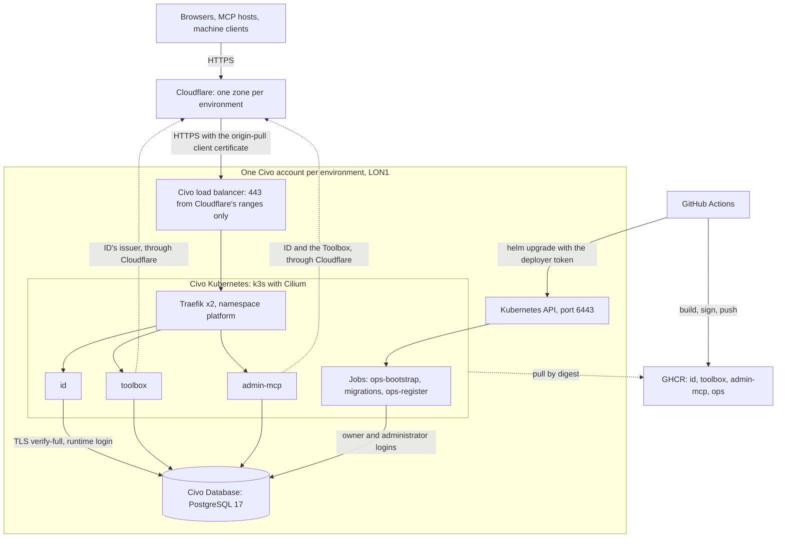

# Deployment

> **TL;DR**
> - **Decides:** where Answerable ID, the Toolbox and the admin MCP run outside a laptop, and why: Civo London, one Civo account per environment, one Helm chart on Civo Kubernetes, Civo Database PostgreSQL 17, Cloudflare in front, secrets encrypted in the repository, a push to `main` deploying staging and one approved click deploying production.
> - **Rule:** only Cloudflare reaches the services, and only with the origin-pull certificate; no service holds a database owner login; the cluster runs images by digest, built from a commit that passed CI; no secret sits in plain text in git, in a Terraform variable or in a log.
> - **Not here:** how to do each step ([`infra/README.md`](../infra/README.md), the runbook), what ID itself needs from any deployment ([`06-deploying-answerable-id.md`](06-deploying-answerable-id.md)), the decisions with the alternatives they rejected ([`goals/aws-deploy/decisions.md`](goals/aws-deploy/decisions.md), D-numbers below), the measured evidence from the first staging deployment (`reports/staging-evidence.md`, written by brief B7a: Not yet).

**Status.** Everything below is code in this repository, proved locally (§ [Testing](#testing)). Nothing is applied to Civo yet: the first staging deployment is brief [B7a](goals/aws-deploy/briefs/b7.md), and production waits for it, for OpenBao ([B7b](goals/aws-deploy/briefs/b7b.md)) and for the rehearsal ([B7c](goals/aws-deploy/briefs/b7c.md)). The web app stays on Vercel.

## What runs where

| Piece | Where | Count per environment | Defined in |
| --- | --- | --- | --- |
| **Answerable ID** (`id`) | Deployment in namespace `answerable`, port 47300 | 2 to 4 (staging), 2 to 6 (production) | [`charts/answerable`](../charts/answerable/README.md) |
| **The Toolbox** (`toolbox`) | Deployment in `answerable`, port 47400 | 2 to 3, 2 to 4 | the same |
| **The admin MCP** (`admin-mcp`) | Deployment in `answerable`, port 47520 | 2 to 3, 2 to 4 | the same |
| **Migrations and ops Jobs** | Helm hook Jobs in `answerable`: `ops-bootstrap`, `id-migrate`, `toolbox-migrate`, `admin-migrate`, `ops-register` | one run per deploy | the same, and [`infra/ops`](../infra/ops/README.md) |
| **Traefik** (the edge in the cluster) | Deployment in namespace `platform`, behind a Civo load balancer | 2 | [`charts/platform`](../charts/platform/README.md) |
| **cert-manager** | Namespace `platform`; a namespaced Issuer `letsencrypt` in `answerable` | 1 | the same |
| **PostgreSQL 17** | Civo Database on the environment's private network: `answerable_id`, `answerable_toolbox`, `answerable_admin` | 1 node (staging), 3 nodes (production) | [`infra/civo`](../infra/civo/README.md) |
| **Cluster, network, firewalls, state bucket, Cloudflare zone** | One Civo account and one Cloudflare zone per environment, Civo region LON1 | 2 nodes (staging), 3 nodes (production), Medium | `infra/civo/envs/<environment>` |
| **Images** | GHCR, public: `ghcr.io/rieranthony/answerable/{id,toolbox,admin-mcp,ops}` | one manifest list per image and commit | the Dockerfiles, `deploy-staging.yml` |
| **The pipeline** | GitHub Actions: `deploy-staging.yml`, `promote-production.yml`, `ops.yml`, `infra.yml` | | [`infra/pipeline`](../infra/pipeline/README.md) |

| Hostname | Staging (zone `answerable-staging.uk`) | Production (zone `answerable.org`) |
| --- | --- | --- |
| ID, the issuer | `id.answerable-staging.uk` | `id.answerable.org` |
| The Toolbox | `toolbox.answerable-staging.uk` (resource `/mcp`, admin API `/admin`) | `toolbox.answerable.org` |
| The admin MCP | `admin-mcp.answerable-staging.uk` (resource `/mcp`) | `admin-mcp.answerable.org` |

Every name is first-level in its zone, so Cloudflare's Universal SSL covers it without an add-on ([D12](goals/aws-deploy/decisions.md)). Production's records sit beside Vercel's DNS-only `www`, which Terraform never touches.

The Toolbox and the admin MCP call ID at its public issuer, through Cloudflare, so one URL is the issuer everywhere.

## Accounts and access

| Who or what | Holds | Reaches |
| --- | --- | --- |
| **The owner** | Each Civo account's API key; each zone's two Cloudflare tokens; each environment's `age` private key; the state bucket's credential | Everything, from a trusted machine |
| **`infra-staging` GitHub environment** | `CIVO_TOKEN`, `CLOUDFLARE_API_TOKEN`, `STATE_ACCESS_KEY_ID`, `STATE_SECRET_ACCESS_KEY`, `ALLOWED_API_CIDRS` | Staging's Terraform apply (on every push to `main`) and plan (on pull requests) |
| **`staging` GitHub environment** | `KUBE_SERVER`, `KUBE_CA`, `KUBE_TOKEN`, `SOPS_AGE_KEY` | The `answerable` namespace only, through the `deployer` ServiceAccount |
| **`production` GitHub environment** | All nine of the above for production, behind the owner's approval | Production's Terraform and its `answerable` namespace |
| **The `deployer` ServiceAccount** | A token Terraform creates | Only what `helm upgrade` of `charts/answerable` touches in `answerable`: no other namespace, no wildcard, no `escalate`, `bind`, `impersonate` or `exec` |

- **One Civo account per environment** under one Civo organisation ([D28](goals/aws-deploy/decisions.md)): a staging credential, bug or Terraform mistake cannot touch production. It is the strongest boundary Civo offers.
- **Teams** live in Civo's dashboard, not in Terraform ([B0](goals/aws-deploy/briefs/b0.md)): the owner in each account's Owners team with MFA on the login, colleagues and agents in a Technical Administrator team.
- **No long-lived cloud key in the deploy.** Civo has no federation and no scoped API keys: a key is per account, unscoped, with no documented expiry. The key therefore lives only with the owner and in the infra environments; the deploy jobs hold the namespace-scoped `deployer` token instead ([D25](goals/aws-deploy/decisions.md)).
- **The owner's personal 1Password is not used** by any automation ([D23](goals/aws-deploy/decisions.md)).
- **Break-glass access** to a cluster is its admin kubeconfig, the sensitive Terraform output `admin_kubeconfig`, for diagnostics and recovery only ([runbook](../infra/README.md#break-glass)).
- **The state is a secret.** Civo's provider keeps the database administrator's password and the admin kubeconfig in Terraform state, which also holds the deployer's token. The state bucket's credential is therefore guarded like `CIVO_TOKEN`.

## Network and ingress

A request travels Cloudflare → the Civo load balancer → Traefik → a service. Each hop checks the one before it.

| Layer | What it enforces |
| --- | --- |
| **Cloudflare** ([D18](goals/aws-deploy/decisions.md), [D19](goals/aws-deploy/decisions.md)) | Proxied A records for the three hostnames; SSL Full (strict); Always Use HTTPS; TLS 1.2 minimum, TLS 1.3 on; HSTS for a year (no subdomains, no preload); zone-level Authenticated Origin Pulls with Answerable's own client certificate; on the three hostnames no Browser Integrity Check, Security Level essentially off, and no cache except `/assets/`. Bot Fight Mode is off by hand: the token cannot change it. All of it is Terraform, in the root's `edge` module, except Bot Fight Mode |
| **Load balancer firewall** | TCP 443 from Cloudflare's published IPv4 ranges only, read by Terraform at apply time; no port 80 |
| **Traefik** ([D31](goals/aws-deploy/decisions.md)) | TLS with cert-manager's Let's Encrypt certificates (DNS-01 in the environment's zone); every TLS connection must present a client certificate signed by the environment's origin-pull CA, through the TLSOptions `origin-pull` and `default`, either of which alone keeps a host closed; strict SNI; `X-Forwarded-For` kept only from Cloudflare's ranges and the private network, and the connecting address appended |
| **NetworkPolicy** | Default deny in `answerable`; each service admits only Traefik's pods; egress to DNS, the database's network and HTTPS outside the private ranges; the migrations reach DNS and the database only |
| **ID** | `TRUSTED_PROXY_CIDRS` is Cloudflare's 22 ranges, the private network and the pod range `10.42.0.0/16`; a production request to `/auth/*` or `/api/admin/*` with no untrusted address left is refused `403 untrusted_ingress` |

- **Private network.** Each environment has its own Civo network (`10.10.0.0/24` staging, `10.20.0.0/24` production) holding the nodes, the load balancer and the database, and nothing else.
- **Three firewalls.** The **cluster's**: 6443 (the Kubernetes API) as below, and from the private network only the node ports, the kubelet and Cilium's tunnel and health checks. The **load balancer's**: 443 from Cloudflare. The **database's**: 5432 from the private network.
- **Why the private network is trusted for forwarded headers.** No PROXY protocol is configured, so Traefik's peer is the load balancer's private address; trusting that range is what keeps Cloudflare's `X-Forwarded-For`. Whether that holds on Civo is a first-apply question ([`infra/civo/README.md`](../infra/civo/README.md#what-the-first-apply-must-confirm)).
- **The Kubernetes API is public on Civo** (Civo clusters always have a public address). **Production** admits only the operators' addresses in `ALLOWED_API_CIDRS`. **Staging** admits the whole internet on 6443, authenticated by the cluster alone, because GitHub's hosted runners publish more than 5,000 IPv4 ranges, too many for a firewall ([D30](goals/aws-deploy/decisions.md)). The consequence for production: GitHub's runners cannot reach its API, so `promote-production.yml` cannot deploy production until the follow-up lands. The follow-up, for the owner to pick: a GitOps controller pulling from inside the cluster, or a Cloudflare tunnel in front of the API. Not yet.

## Compute

- **Kubernetes, because it is the only compute layer Civo, AWS and Google all sell** ([D20](goals/aws-deploy/decisions.md)). Civo Kubernetes is k3s with Cilium; Civo's own Traefik is removed and ours is installed by the platform chart, so the version is pinned in the repository.
- **One chart, `charts/answerable`** ([D21](goals/aws-deploy/decisions.md)): per server a ServiceAccount, Deployment, Service, Ingress, HorizontalPodAutoscaler and PodDisruptionBudget, plus the migration and ops Jobs. Per environment a values overlay: `values-civo-staging.yaml`, `values-civo-production.yaml` (and `values-local.yaml` for the kind stack).
- **Scaling.** HorizontalPodAutoscalers on CPU (60% of requests): ID 2 to 4 in staging and 2 to 6 in production, the MCPs 2 to 3 and 2 to 4. Replicas spread over nodes; production refuses to place two replicas on one node (`DoNotSchedule`). Each PodDisruptionBudget allows one pod down at a time.
- **Rolling deploys.** `maxUnavailable: 0`, `maxSurge: 1`; readiness on `/readyz` (ID) and `/health` (the MCPs); a startup probe; liveness on `/healthz` for ID and a TCP check for the MCPs, so that a database outage does not restart every MCP pod. `helm upgrade --rollback-on-failure --wait` rolls the release back when a Job fails or the pods never become ready.
- **Restricted Pod Security** is enforced on `answerable`: every container runs as uid 1000, with a read-only root filesystem, no privilege escalation, every capability dropped and seccomp `RuntimeDefault`; no pod mounts a ServiceAccount token except the ops Jobs.
- **The MCPs wait for their client secrets.** The Toolbox and the admin MCP render at zero replicas until `ops-register` has written `toolbox-id-client` and `admin-id-client`; the register Job then starts them.
- **Images.** From `oven/bun:1.3.1-slim` pinned by digest, non-root, `NODE_ENV=production`, no test, coverage, `.env` or Markdown file. Measured on arm64: `id` 287 MB, `toolbox` 247 MB, `admin-mcp` 218 MB, `ops` 218 MB.
- **Nodes.** Medium (2 vCPU, 4 GB): two in staging, three in production, so that one can drain for maintenance with two replicas per service still on different nodes.

## Database

| | Staging | Production |
| --- | --- | --- |
| **Service** | Civo Database, PostgreSQL 17, **in beta** (Civo offers no other version) | the same |
| **Size** | Small: 2 vCPU, 4 GB, 40 GB NVMe | Medium: 4 vCPU, 8 GB, 80 GB NVMe |
| **Nodes** | 1 | 3 (Civo's "additional nodes" for fault tolerance) |
| **Reach** | 5432 from the private network only | the same |

- **Two logins per database** ([D5](goals/aws-deploy/decisions.md), [B1](goals/aws-deploy/briefs/b1.md)): an owner (`answerable_<name>_owner`) that only the migration Jobs receive, and a runtime login (`answerable_<name>_runtime`) the service runs as. All three services refuse to start as an owner or a privileged role. The `ops-bootstrap` Job creates the databases, the six logins and their URL Secrets with Civo's administrator login, which no service receives.
- **Verified TLS.** Every URL ends `?sslmode=verify-full&sslrootcert=/etc/ssl/db/ca.pem`; the chart mounts the ConfigMap `postgres-ca` there, rendered from `infra/civo/envs/<environment>/database-ca.pem`. Civo's Terraform resource exposes no CA certificate, so that file is **trust on first use**: `bun run setup database-ca` keeps the root of the chain the database presented and prints its fingerprint for the owner to record. Which certificate Civo presents, and whether it names the private address the services use, is recorded by B7a. Not yet.
- **Additional nodes.** Production runs three; how Civo fails over between them is undocumented and B7c checks it.
- **Backups.** Civo's page says "automatic backups" and documents no schedule, retention or restore. The `civo` CLI offers `database backup` and `database restore`. A restore drill on Civo precedes any production data ([D26](goals/aws-deploy/decisions.md)); its RTO and RPO are B7a's measurements. A restored database is unreadable without the keys that were active when its rows were written, and git keeps every version of the encrypted secrets file ([runbook](../infra/README.md#restore)).
- **Connections.** At the autoscalers' ceilings the services open up to 140 connections in staging (ID 4 × 20, the MCPs 3 × 10 each) and 200 in production (6 × 20, 4 × 10, 4 × 10), plus the Jobs. Civo's `max_connections` per size is measured in B7a. Not yet.
- **Growth.** ID's `audit_events` and `admin_operations`, and the MCPs' evidence, are kept forever. At the [cost simulation](goals/aws-deploy/cost-simulation.md)'s 100 organisations of 1,000 users that is about 26 GB a month: production's 80 GB fills in about three months, and Civo bundles storage with the size. Deciding retention ([`Q-EVIDENCE-RETENTION`](02-plan.md#open-register)) is a prerequisite for production data on Civo.

## Secrets

**As built: `sops` and `age`, no secret store** ([D23](goals/aws-deploy/decisions.md)). OpenBao replaces it in brief [B7b](goals/aws-deploy/briefs/b7b.md) ([D29](goals/aws-deploy/decisions.md)): Not yet.

- **Human-provided secrets** live encrypted in the repository, one file per environment, `infra/civo/envs/<environment>/secrets.enc.yaml`: several YAML documents, each a Kubernetes `Secret` in `answerable`. `.sops.yaml` at the root names each environment's `age` recipient with `encrypted_regex: ^(data|stringData)$`, so the Secrets' names and keys stay readable in a review and only the values are ciphertext. `bun run setup init-secrets` generates the file; the deploy pipes `sops --decrypt` into `kubectl apply` and never writes or prints the plaintext.
- **Generated secrets never leave the cluster.** `ops-bootstrap` writes the six database URLs and `ops-register` the two machine-client secrets straight into Kubernetes Secrets. A rebuilt cluster re-runs both: bootstrap sets a new password for a login whose Secret is gone, register rotates a client secret it cannot find.
- **Terraform holds no secret value as input.** It does hold provider-made ones in state (above).
- **Kubernetes Secrets rest in Civo's etcd**, whose encryption at rest is undocumented.

| Secret in `answerable` | Keys | Written by | Rotated by |
| --- | --- | --- | --- |
| `id-env` | `BETTER_AUTH_SECRET`, `UPSTREAM_TOKEN_SECRETS`, `ROOT_ADMIN_SECRET`; `MICROSOFT_CLIENT_ID` with `MICROSOFT_CLIENT_SECRET` and `GOOGLE_CLIENT_ID` with `GOOGLE_CLIENT_SECRET` when given | `init-secrets`, into `secrets.enc.yaml`; the deploy applies it | `init-secrets --rotate <key>`; `BETTER_AUTH_SECRET` only through the `BETTER_AUTH_SECRETS` ring |
| `postgres-admin` | `OPS_DATABASE_ADMIN_URL` | `init-secrets`, from Terraform's `database_admin_url` | `init-secrets --rotate OPS_DATABASE_ADMIN_URL` |
| `cloudflare-api-token` | `api-token`: Zone > DNS > Edit and Zone > Zone > Read on the one zone, for cert-manager | `init-secrets`, from `CERT_MANAGER_CLOUDFLARE_TOKEN` | `init-secrets --rotate api-token` |
| `id-database`, `id-database-owner`, `toolbox-database`, `toolbox-database-owner`, `admin-database`, `admin-database-owner` | `DATABASE_URL`, `DATABASE_MIGRATION_URL` and the `TOOLBOX_` and `ADMIN_` equivalents | `ops-bootstrap` | Empty the key, deploy |
| `toolbox-id-client`, `admin-id-client` | `TOOLBOX_ID_CLIENT_SECRET`, `ADMIN_ID_CLIENT_SECRET` | `ops-register` | Empty the key, register again |
| `ops-staff-token` | `OPS_ID_TOKEN` | The owner, by hand, only while registering again after root has locked | Delete it after use |
| `cloudflare-origin-pull-ca` | `ca.crt`, public | The platform chart, from `edge-ca/ca.pem` | `bun run setup origin-pull --force` |
| `id-tls`, `toolbox-tls`, `admin-mcp-tls` | the certificates | cert-manager | cert-manager, before expiry |

**The one key to guard is each environment's `age` private key.** Whoever holds it reads every human secret of that environment, including the root secret. It lives in two places: the owner's machine (`~/.config/sops/age/answerable-<environment>.txt`, wherever the owner keeps their own secrets) and the GitHub environment's `SOPS_AGE_KEY`. Losing it loses nothing that cannot be regenerated, except the ability to read older versions of the file, which a database restore may need: keep it while any backup it protects exists.

Public, committed, per environment: `.sops.yaml`, `infra/civo/envs/<environment>/edge-ca/ca.pem` (the origin-pull CA's certificate) and `database-ca.pem`. The origin-pull client key goes to Cloudflare and nowhere else.

## Images and deploys

- **Registry: GHCR**, public, one place for every cloud ([D24](goals/aws-deploy/decisions.md)). Tag `sha-<40-character commit SHA>`, never a mutable name.
- **Built once per commit**, for `linux/amd64` and `linux/arm64` on native runners (Civo does not document its nodes' architecture), with provenance and an SBOM, then joined into one manifest list per image and **signed with cosign**, keyless, by `deploy-staging.yml` on `main`.
- **Deployed by digest.** The deploy resolves each tag to its manifest-list digest and the chart runs `<repository>@sha256:…`, so a moved tag changes nothing.

**A push to `main`** ([`deploy-staging.yml`](../.github/workflows/deploy-staging.yml)):

1. CI (`ci.yml`): typecheck, lint, build, every test suite, `infra:check` and `infra:test`.
2. Only when the repository variable `DEPLOY_STAGING` is `true` (set by `bun run setup publish-env --enable`): `terraform apply` of `infra/civo/envs/staging`, a no-op when nothing changed.
3. Build, join and sign the four images.
4. Deploy: apply the decrypted Secrets, then `helm upgrade --install` with `--rollback-on-failure`. The hooks run in order: the `postgres-ca` ConfigMap, `ops-bootstrap` (every deploy; it changes nothing when nothing is missing), `id-migrate`, `toolbox-migrate`, `admin-migrate`, then the release, then `ops-register` when either client Secret is missing (the first install).
5. Smoke test through Cloudflare: ID's health, readiness, discovery and keys, the MCPs' health and metadata, retried for five minutes.

**The production click** ([`promote-production.yml`](../.github/workflows/promote-production.yml), [D8](goals/aws-deploy/decisions.md)): read the tag staging runs (or take an earlier one), verify the four signatures against `deploy-staging.yml@refs/heads/main`, wait for the owner's approval, apply `infra/civo/envs/production`, deploy exactly the verified digests, smoke-test. Production is never rebuilt. Until D30's follow-up, GitHub cannot reach production's API, so this workflow cannot complete (above).

- **Roll back** by redeploying an earlier tag (`Deploy staging` or `Promote production` by hand), or `helm rollback` with a kubeconfig.
- **Migrations are expand, then contract** ([D10](goals/aws-deploy/decisions.md)): a migration never breaks the image before it, because that image keeps serving during the rollout and after a rollback. A change that cannot be written that way needs a restore, not a rollback.
- **Registering again** (a rotated client secret, a changed registration) is `ops.yml`; once a person holds `platform:write` it needs a staff token in `ops-staff-token`.

## Observability

| Signal | State |
| --- | --- |
| Pod logs, including ID's `[id] operations` lines and the Jobs' logs | On: `kubectl logs` with a kubeconfig; a failed deploy prints the migration and ops Jobs' logs in the workflow |
| The deploy's smoke test | On: every deploy, through Cloudflare |
| `helm history answerable -n answerable` | On: the deploy log |
| ID's audit trail | On: `GET /api/admin/v1/audit-events`, whatever the cloud |
| Civo's view of the database | Whatever the Civo dashboard shows; not measured yet |
| The Grafana agent (`k8s-monitoring`, a dependency of `charts/platform`) and Grafana Cloud | Off (`monitoring.enabled: false`) until a Grafana Cloud workspace exists. Not yet |
| Alerts | Not yet |
| The Toolbox's OTLP spans | Off: `OTEL_EXPORTER_OTLP_ENDPOINT` unset |
| An audit log of Civo API calls | None that Civo documents |

## Cost

Civo's list prices, measured on 10 October 2026 from its pricing page; USD a month, before VAT ([portability](goals/aws-deploy/portability.md#cost-three-ways)).

| Line | Staging | Production |
| --- | --- | --- |
| Nodes | 2 × Medium, $43.46 | 3 × Medium, $65.19 |
| PostgreSQL 17 | Small, $43.45 | Medium, $86.91; the two additional nodes are priced separately and not listed (assumed about $173, three times in all) |
| Load balancer | $10.86 | $10.86 |
| Object store for the state, one 500 GB block | $5.43 | $5.43 |
| Cloudflare (free plan), GHCR and GitHub Actions (public repository) | $0 | $0 |
| **Total** | **about $103** | **about $170 with one database node; about $340 with three, as configured** |

- Two Small nodes instead of Medium bring staging to about $82, with less room for the platform pods.
- **The audit-growth caveat.** Storage is bundled with the database size, so the only line that keeps growing is the database: at the cost simulation's activity, production's Medium database is full after about three months and the next size costs $86.90 more. Retention (`Q-EVIDENCE-RETENTION`) decides it.
- Production costs nothing until its first apply.

## Testing

| Check | Proves | Needs |
| --- | --- | --- |
| `bun run infra:check` | Both charts lint and validate (`helm lint --strict`, `kubeconform` for every overlay); `terraform fmt`, `validate` and `terraform test` with mocked providers for every module and root (the firewall rules, names, RBAC and refusals); the two roots identical but for `backend.tf`; `tflint`; `trivy config` (no HIGH or CRITICAL); `actionlint` on the workflows | No cloud account, no Docker |
| `bun run infra:test` ([the kind stack](../infra/k8s/local/README.md)) | The four real images in a kind cluster with both charts, Traefik, cert-manager and a TLS-only PostgreSQL 17: refusal without the origin-pull certificate, the forged-header walk, restricted runtime logins, `verify-full`, NetworkPolicies, `ops-bootstrap` and `ops-register`, a machine token, a staff sign-in in Chromium and an admin MCP call, the Jobs again changing nothing, each TLS option alone failing closed | Docker, kind, about four minutes |
| `infra/k8s/charts.test.ts` | Every overlay renders with its invariants: digests, the restricted security context, hooks, issuers, trusted ranges | Helm |
| `infra/ops`, `infra/pipeline`, `infra/setup` suites | The commands against fakes, at 100% line and function coverage | Bun |
| `bun run --filter @answerable/infra-pipeline rehearse` | The deploy scripts with the real `kubectl`, Helm 4 and `sops` against a throwaway kind cluster, signed in as a namespace-scoped token | Docker, kind |
| `bun run --filter @answerable/infra-setup prove` | The setup commands with the real `age-keygen`, `sops`, OpenSSL 3 and a TLS PostgreSQL 17 | Docker |
| The smoke test | Each deployed environment through Cloudflare, after every deploy | The environment |

**Only B7a's evidence proves** what needs Civo and Cloudflare themselves: the answers to the [first-apply questions](../infra/civo/README.md#what-the-first-apply-must-confirm) (the state lock on Civo's object store, the load balancer through the firewalls, the address Traefik sees, the database's certificate and default database), the first Let's Encrypt certificate through DNS-01, origin pulls end to end, ID recording a real client address through Cloudflare, the backup and restore, `max_connections`, and the real monthly cost.

## Not yet

- **D30's follow-up**: a Kubernetes API that GitHub can reach without being open to the internet, through a GitOps controller pulling from inside the cluster or a Cloudflare tunnel. Until then staging's API is open (authenticated) and production cannot be deployed from GitHub.
- **OpenBao** as the secret store, with per-service identities, a read audit and snapshots: [B7b](goals/aws-deploy/briefs/b7b.md) ([D29](goals/aws-deploy/decisions.md)).
- **The first staging deployment and its evidence** (`reports/staging-evidence.md`), and the production rehearsal: [B7a](goals/aws-deploy/briefs/b7.md), [B7c](goals/aws-deploy/briefs/b7c.md).
- **The Grafana Cloud agent and alerts.**
- **Image signature enforcement in the cluster** (an admission policy); today the signatures are checked by `promote-production.yml` only.
- **GitOps** as the deploy model.
- **The AWS and Google roots.** The images, charts, secrets scheme and pipeline are cloud-neutral; each cloud needs its own thin Terraform root ([portability](goals/aws-deploy/portability.md)).
- **From D15:** a second region, Redis, an email provider, KMS-backed token signing ([`Q-AID-KMS`](02-plan.md#open-register)), scheduled scale-to-zero for staging, Cloudflare Access in front of the admin MCP.
- **Bot Fight Mode as code** (the token would need Bot Management Edit).
- **Cloudflare's managed WAF rules as code.** [D18](goals/aws-deploy/decisions.md) names the free managed ruleset; the `edge` module does not set it, so the zone keeps whatever Cloudflare enables by default.
- **A retention decision** for audit and evidence rows ([`Q-EVIDENCE-RETENTION`](02-plan.md#open-register)).
